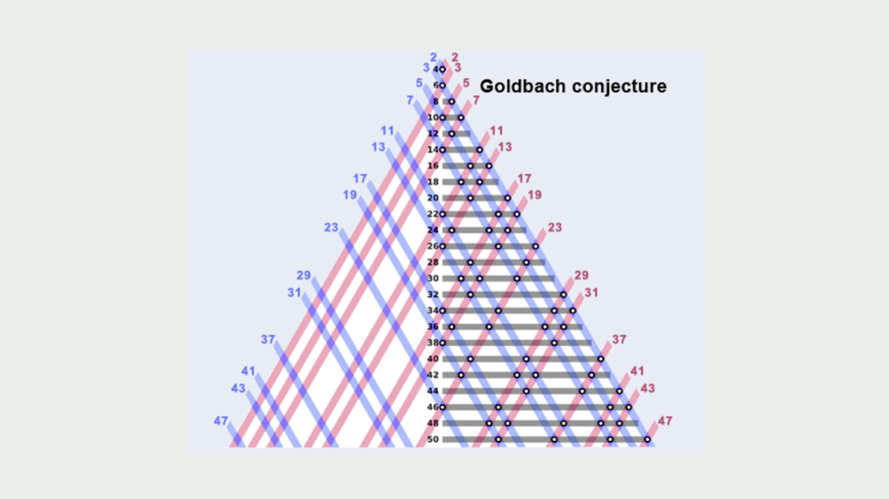
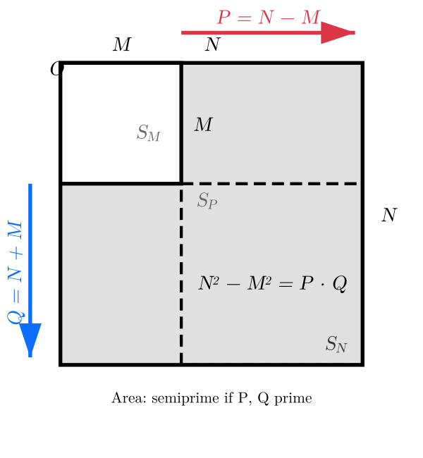

# Experimental Results on Goldbach's Conjecture

**Author:** Frank Vega  
**Institution:** Information Physics Institute, Hialeah, FL, USA

**Keywords:** Goldbach conjecture, differences of primes, additive energy, explicit sieve bounds, prime gaps, Cramér's conjecture, computational evidence

---

## Abstract

The distinct-prime Goldbach conjecture asserts that for every $N \geq 4$ there is $M \in A_N = [1, N-3]$ with $N-M$ and $N+M$ both prime; geometrically, nested squares of side lengths $N$ and $M$ have an L-shaped difference of semiprime area $(N-M)(N+M)$. With $C_N$ and $D_N$ the sets of $M \in A_N$ for which $N-M$, respectively $N+M$, is prime, the conjecture for $2N$ is $C_N \cap D_N \neq \emptyset$. We embed this centered condition in a straddling one: $C_N \cap D_N$ lies in the set $E_N$ of half-differences $(Q-P)/2 \in A_N$ of primes $2 < P < N < Q < 2N$. From Mikawa's theorem on prime pairs with almost all differences we deduce $|A_N \setminus E_N| \ll_D N/(\log N)^D$ for every $D > 0$, and with explicit constants we prove $|E_N| > N/760$ for every $N \geq 3275$. Consequently, for all large $N$ and all but $O_D(N/(\log N)^D)$ primes $P < N$, the number $2N - P$ becomes prime after adding the difference $P' - P$ of two primes $P' < N$; Goldbach's partition is the case $P' = P$. In contrast, $|C_N \cap D_N| < (N-3) - \log^2(2N)$ for every $N \geq 34$, and covering all but $\log^2(2N)$ values of $A_N$ for all large $N$ would imply the Cramér-type bound $p' - p < 2\log^2(2p+2) + 2$. The method also shows that $2N$ is a sum of two distinct primes for more than $X/9600$ integers $N \leq X$, for every $X \geq 10^6$. Computations up to $N = 10^6$ compare the number of distinct-prime partitions with the Hardy–Littlewood prediction and measure the missing values of $E_N$ forced by prime gaps. The conjecture itself is not proved here.

---

## 1. The Problem

The Goldbach conjecture asserts that every even integer greater than 2 is the sum of two primes. We study the variant with **distinct** primes:

> **Distinct-prime Goldbach conjecture:** every even integer $2N \geq 8$ is the sum of two distinct primes.

This excludes only $4 = 2 + 2$ and $6 = 3 + 3$. For $N \geq 4$ it is equivalent to the existence of $M \geq 1$ with $N - M$ and $N + M$ both prime; this symmetric form is known (OEIS [A082467](https://oeis.org/A082467)).

The even Goldbach conjecture has been verified for all even integers up to $4 \cdot 10^{18}$ by Oliveira e Silva, Herzog and Pardi, and the least prime of a Goldbach partition of every such integer is at most $9781$. Together with our computation, this gives a partition into two **distinct** primes for every $8 \leq 2N \leq 4 \cdot 10^{18}$. The conjecture is therefore equivalent to its statement for $N > 2 \cdot 10^{18}$.

---

## 2. The Geometric Form

Start with a square $S_N$ of side length $N \geq 4$. Inside it, place a smaller square $S_M$ of side length $M$ (where $1 \leq M \leq N-3$) sharing the same corner. The L-shaped region between them has area:

$$N^2 - M^2 = (N - M)(N + M)$$

Let $P = N - M$ and $Q = N + M$. Then $P + Q = 2N$ and $P \cdot Q = N^2 - M^2$. Since $M \geq 1$ and $P \geq 3$, the numbers $P$ and $Q$ are distinct, and both must be odd to be prime.

**$2N$ is the sum of two distinct primes $\Longleftrightarrow$ for some $M \in [1, N-3]$, both $P = N - M$ and $Q = N + M$ are prime $\Longleftrightarrow$ the L-shaped area is a semiprime for some $M \in [1, N-3]$.**

   
     
   <em><strong>Figure 1:</strong> The L-shaped region between nested squares. For N=5, M=2: P=3 and Q=7 (both prime), giving area 21 = 3×7 and sum 3+7=10.</em>

---

## 3. Centered and Straddling Prime Pairs

Let $A_N = \\{1, \dots, N-3\\}$ and define

$$C_N = \\{M \in A_N : N - M \text{ is prime}\\}, \qquad D_N = \\{M \in A_N : N + M \text{ is prime}\\}.$$

Then $2N$ is the sum of two distinct primes if and only if $C_N \cap D_N \neq \emptyset$, and $R(2N) = |C_N \cap D_N|$ is the number of such partitions. An element $M \in C_N \cap D_N$ gives a prime pair $(N-M, N+M)$ **centered** at $N$.

The **half-difference set** asks only for a prime pair that **straddles** $N$:

$$E_N = \left\\{\frac{Q - P}{2} \in A_N : P, Q \text{ prime},\ 2 < P < N < Q < 2N\right\\}.$$

Every centered pair straddles $N$, so $C_N \cap D_N \subseteq E_N$. The coverage statistic of $E_N$ is

$$H(N) = \log^2(2N) - |A_N \setminus E_N| = \log^2(2N) - \bigl((N - 3) - |E_N|\bigr),$$

where $\log$ is the natural logarithm.

---

## 4. Main Results

**(1) Coverage of $A_N$ by straddling pairs.**

* From Mikawa's theorem on the Hardy–Littlewood asymptotic for prime pairs with almost all differences: $|A_N \setminus E_N| \ll_D N/(\log N)^D$ for every $D > 0$, so $|E_N| = N - o(N)$.
* With explicit constants: $|E_N| > N/760$ for every $N \geq 3275$. The proof combines the Cauchy–Schwarz inequality, an exact identity for the additive energy of the primes below and above $N$, Siebert's explicit sieve bound, and the estimates of Dusart and of Rosser and Schoenfeld.

**(2) Goldbach partitions up to a difference of two primes.**

* For every $D > 0$, $|C_N \cap E_N| = \pi(N-1) - 1 + O_D(N/(\log N)^D)$.
* Equivalently, for all but $O_D(N/(\log N)^D)$ primes $3 \leq P < N$ there are primes $2 < P' < N < Q' < 2N$ with

$$Q' = (2N - P) + (P' - P).$$

* A distinct-prime Goldbach partition $2N = P + Q'$ is the case $P' = P$.
* With explicit constants: if $H(N) > 0$ and $N \geq 356$, then $C_N \cap E_N \neq \emptyset$.

**(3) The centering step.**

* $|C_N \cap D_N| < (N - 3) - \log^2(2N)$ for every $N \geq 34$, while $|E_N| = N - o(N)$.
* The prime gap around $N$ and the prime gap below $2N$ force missing values of $E_N$: if $p^- < N < p^+$ are consecutive primes, every $M < (p^+ - p^-)/2$ is missing; if $q$ is the largest prime below $2N$, every $M > (q - 3)/2$ is missing.
* Consequently, $H(N) > 0$ for all large $N$ would imply $p' - p < 2\log^2(2p + 2) + 2$ for consecutive primes $p < p'$ (a Cramér-type bound), and the theorem of Ford, Green, Konyagin, Maynard and Tao on long prime gaps shows that $|A_N \setminus E_N|$ is unbounded.

**(4) An explicit positive proportion of Goldbach numbers.** For every $X \geq 10^6$, more than $X/9600$ integers $4 \leq N \leq X$ have $R(2N) \geq 1$.

---

## 5. Computational Results

Two scripts produce the data. Their output uses the names of an earlier notation: in the output of `experiment.py`, $D_N$ denotes $E_N$, $S_N$ denotes $C_N \cap D_N$, and $G(N)$ denotes $H(N)$. The intervals are $I_2 = [4, 8]$ and $I_m = (2^m, 2^{m+1}]$ for $m \geq 3$.

### 5.1 `experiment.py` ($4 \leq N \leq 2^{14}$, 18.7 s)

**Table 1: Minimum of $H(N)$ on each interval**

| $m$ | Range $I_m$          | Min at $N$ | Min $H(N)$ |
| :-- | :------------------- | :--------- | :--------- |
| 2   | $[4, 8]$             | 5          | 4.301898   |
| 3   | $(2^3, 2^4]$         | 9          | 7.354249   |
| 4   | $(2^4, 2^5]$         | 19         | 10.232033  |
| 5   | $(2^5, 2^6]$         | 61         | 14.078618  |
| 6   | $(2^6, 2^7]$         | 73         | 17.836335  |
| 7   | $(2^7, 2^8]$         | 151        | 20.608977  |
| 8   | $(2^8, 2^9]$         | 269        | 23.537165  |
| 9   | $(2^9, 2^{10}]$      | 541        | 28.812111  |
| 10  | $(2^{10}, 2^{11}]$   | 1327       | 33.154668  |
| 11  | $(2^{11}, 2^{12}]$   | 2161       | 35.081569  |
| 12  | $(2^{12}, 2^{13}]$   | 7069       | 42.329014  |
| 13  | $(2^{13}, 2^{14}]$   | 14138      | 44.057758  |

**Table 2: Minimum of the centered statistic $H_R(N) = \log^2(2N) - ((N-3) - R(2N))$**

| $m$ | Range $I_m$          | Min at $N$ | Min $H_R(N)$ |
| :-- | :------------------- | :--------- | :----------- |
| 2   | $[4, 8]$             | 7          | 3.96         |
| 3   | $(2^3, 2^4]$         | 16         | 1.01         |
| 4   | $(2^4, 2^5]$         | 31         | −8.97        |
| 5   | $(2^5, 2^6]$         | 64         | −34.46       |
| 6   | $(2^6, 2^7]$         | 128        | −86.25       |
| 7   | $(2^7, 2^8]$         | 256        | −203.08      |
| 8   | $(2^8, 2^9]$         | 511        | −441.98      |
| 9   | $(2^9, 2^{10}]$      | 1024       | −937.87      |
| 10  | $(2^{10}, 2^{11}]$   | 2047       | −1923.82     |
| 11  | $(2^{11}, 2^{12}]$   | 4096       | −3935.80     |
| 12  | $(2^{12}, 2^{13}]$   | 8191       | −7953.83     |
| 13  | $(2^{13}, 2^{14}]$   | 16369      | −16029.92    |

Further results for every $4 \leq N \leq 2^{14}$:

* $R(2N) \geq 1$: every even integer $8 \leq 2N \leq 2^{15}$ is the sum of two distinct primes.
* The pigeonhole count $|C_N| > |A_N \setminus E_N|$ holds for every $N$ except $N = 5$ and $N = 7$.
* $(C_N \cap E_N) \setminus D_N \neq \emptyset$ for $16{,}377$ of the $16{,}381$ values of $N$, all except $N \in \\{4, 5, 7, 8\\}$; for instance, $3 \in C_6 \cap E_6$ while $6 + 3 = 9$ is composite.
* The inequality $N/(\log N + 2) - 2 > \log^2(2N)$ fails at $N = 355$ and holds for every $356 \leq N \leq 10^6$; it is proved for every real $N \geq 356$ in the paper.

**Small cases:**

| $N$ | $C_N$ | $E_N$ | $C_N \cap D_N$ | $C_N \cap E_N$ | Partition |
| :-- | :---- | :---- | :------------- | :------------- | :-------- |
| 4  | $\\{1\\}$       | $\\{1\\}$                     | $\\{1\\}$       | $\\{1\\}$       | $8 = 3 + 5$   |
| 5  | $\\{2\\}$       | $\\{2\\}$                     | $\\{2\\}$       | $\\{2\\}$       | $10 = 3 + 7$  |
| 6  | $\\{1,3\\}$     | $\\{1,2,3\\}$                 | $\\{1\\}$       | $\\{1,3\\}$     | $12 = 5 + 7$  |
| 7  | $\\{2,4\\}$     | $\\{3,4\\}$                   | $\\{4\\}$       | $\\{4\\}$       | $14 = 3 + 11$ |
| 8  | $\\{1,3,5\\}$   | $\\{2,3,4,5\\}$               | $\\{3,5\\}$     | $\\{3,5\\}$     | $16 = 3 + 13$ |
| 9  | $\\{2,4,6\\}$   | $\\{2,3,4,5,6\\}$             | $\\{2,4\\}$     | $\\{2,4,6\\}$   | $18 = 5 + 13$ |
| 10 | $\\{3,5,7\\}$   | $\\{2,3,4,5,6,7\\}$           | $\\{3,7\\}$     | $\\{3,5,7\\}$   | $20 = 3 + 17$ |
| 11 | $\\{4,6,8\\}$   | $\\{3,4,5,6,7,8\\}$           | $\\{6,8\\}$     | $\\{4,6,8\\}$   | $22 = 3 + 19$ |
| 12 | $\\{1,5,7,9\\}$ | $\\{1,3,4,5,6,7,8,9\\}$       | $\\{1,5,7\\}$   | $\\{1,5,7,9\\}$ | $24 = 5 + 19$ |

### 5.2 `large_range.py` ($4 \leq N \leq 10^6$, 184.4 s)

**Table A: Coverage of $A_N$ by $E_N$**

| $m$ | Range $I_m$        | Min at $N$ | Min $H(N)$ | Max $\|A_N \setminus E_N\|$ (at $N$) | Min $\|E_N\|/N$ |
| :-- | :----------------- | :--------- | :--------- | :----------------------------------- | :-------------- |
| 2   | $[4, 8]$           | 5          | 4.301898   | 2 (7)                                | 0.200000        |
| 3   | $(2^3, 2^4]$       | 9          | 7.354249   | 2 (11)                               | 0.545455        |
| 4   | $(2^4, 2^5]$       | 19         | 10.232033  | 6 (29)                               | 0.684211        |
| 5   | $(2^5, 2^6]$       | 61         | 14.078618  | 9 (61)                               | 0.803279        |
| 6   | $(2^6, 2^7]$       | 73         | 17.836335  | 10 (113)                             | 0.863014        |
| 7   | $(2^7, 2^8]$       | 151        | 20.608977  | 13 (165)                             | 0.900662        |
| 8   | $(2^8, 2^9]$       | 269        | 23.537165  | 16 (269)                             | 0.929368        |
| 9   | $(2^9, 2^{10}]$    | 541        | 28.812111  | 24 (986)                             | 0.957486        |
| 10  | $(2^{10}, 2^{11}]$ | 1327       | 33.154668  | 29 (1327)                            | 0.975377        |
| 11  | $(2^{11}, 2^{12}]$ | 2161       | 35.081569  | 35 (2161)                            | 0.982416        |
| 12  | $(2^{12}, 2^{13}]$ | 7069       | 42.329014  | 49 (7069)                            | 0.991389        |
| 13  | $(2^{13}, 2^{14}]$ | 14138      | 44.057758  | 61 (14138)                           | 0.994665        |
| 14  | $(2^{14}, 2^{15}]$ | 17863      | 46.906582  | 64 (29443)                           | 0.996305        |
| 15  | $(2^{15}, 2^{16}]$ | 43331      | 55.271687  | 74 (43331)                           | 0.998006        |
| 16  | $(2^{16}, 2^{17}]$ | 66239      | 58.102490  | 90 (107525)                          | 0.998732        |
| 17  | $(2^{17}, 2^{18}]$ | 206699     | 54.240920  | 113 (206699)                         | 0.999315        |
| 18  | $(2^{18}, 2^{19}]$ | 484853     | 55.019283  | 135 (484853)                         | 0.999576        |
| 19  | $(2^{19}, 2^{20}]$ | 668364     | 58.971771  | 140 (668364)                         | 0.999749        |

* $H(N) > 0$ for every $4 \leq N \leq 10^6$; on $I_2, \dots, I_{13}$ the minima coincide with Table 1.
* The minimum of $H(N)$ strictly increases for $2 \leq m \leq 16$; the minimum on $I_{17}$ is smaller than on $I_{16}$, and the minima increase again from $I_{17}$ to $I_{19}$.
* The minimum of $|E_N|/N$ over $3275 \leq N \leq 10^6$ is $0.990603$.
* For $N = 1327$, the missing values are $M = 1, \dots, 19, 22, 25, 28, 34, 43, 50, 1316, 1319, 1323, 1324$. The primes around $1327$ are $1321$ and $1361$, which force $M = 1, \dots, 19$; the largest prime below $2654$ is $2647$, which forces $M = 1323, 1324$.

**Table B: Distinct-prime partitions and the Hardy–Littlewood prediction**

Here $\mathrm{HL}(2N) = \omega \prod_{p \mid N,\ p > 2} \frac{p-1}{p-2} \int_2^{2N-2} \frac{dt}{\log t \, \log(2N - t)}$, with $\omega \approx 0.6601618372$ and the integral computed by 64-point Gauss–Legendre quadrature.

| $m$ | Range $I_m$        | Min $R(2N)$ (at $N$) | Min ratio | Max ratio | Mean ratio |
| :-- | :----------------- | :------------------- | :-------- | :-------- | :--------- |
| 2   | $[4, 8]$           | 1 (4)                | 0.2497    | 0.8705    | 0.5112     |
| 3   | $(2^3, 2^4]$       | 2 (9)                | 0.3711    | 0.6800    | 0.5565     |
| 4   | $(2^4, 2^5]$       | 1 (19)               | 0.2806    | 1.1702    | 0.6706     |
| 5   | $(2^5, 2^6]$       | 2 (34)               | 0.4264    | 1.0380    | 0.7407     |
| 6   | $(2^6, 2^7]$       | 4 (76)               | 0.5738    | 1.0863    | 0.7970     |
| 7   | $(2^7, 2^8]$       | 6 (139)              | 0.5280    | 1.0909    | 0.8530     |
| 8   | $(2^8, 2^9]$       | 9 (271)              | 0.6300    | 1.1322    | 0.8890     |
| 9   | $(2^9, 2^{10}]$    | 16 (556)             | 0.6960    | 1.1621    | 0.9258     |
| 10  | $(2^{10}, 2^{11}]$ | 26 (1039)            | 0.7159    | 1.1448    | 0.9463     |
| 11  | $(2^{11}, 2^{12}]$ | 45 (2104)            | 0.7833    | 1.1361    | 0.9624     |
| 12  | $(2^{12}, 2^{13}]$ | 75 (4276)            | 0.7754    | 1.1131    | 0.9750     |
| 13  | $(2^{13}, 2^{14}]$ | 131 (8311)           | 0.8673    | 1.1129    | 0.9820     |
| 14  | $(2^{14}, 2^{15}]$ | 222 (16519)          | 0.8807    | 1.0906    | 0.9887     |
| 15  | $(2^{15}, 2^{16}]$ | 406 (32789)          | 0.9093    | 1.0711    | 0.9918     |
| 16  | $(2^{16}, 2^{17}]$ | 707 (65551)          | 0.9181    | 1.0570    | 0.9946     |
| 17  | $(2^{17}, 2^{18}]$ | 1279 (132274)        | 0.9424    | 1.0529    | 0.9962     |
| 18  | $(2^{18}, 2^{19}]$ | 2291 (262436)        | 0.9536    | 1.0385    | 0.9975     |
| 19  | $(2^{19}, 2^{20}]$ | 4130 (525166)        | 0.9657    | 1.0296    | 0.9982     |

$R(2N) \geq 1$ for every $4 \leq N \leq 10^6$: every even integer $8 \leq 2N \leq 2 \cdot 10^6$ is the sum of two distinct primes.

**Table C: Missing values of $E_N$ forced by prime gaps**

$F(N)$ is the number of missing values forced by the two gap obstructions of Section 4 (3), and $U(N) = |A_N \setminus E_N| - F(N)$.

| $m$ | Range $I_m$        | Max $\|A_N \setminus E_N\|$ | Max $F(N)$ | Max $U(N)$ (at $N$) | Mean $U(N)$ | Share forced |
| :-- | :----------------- | :-------------------------- | :--------- | :------------------ | :---------- | :----------- |
| 2   | $[4, 8]$           | 2                           | 2          | 0 (4)               | 0.000       | 1.0000       |
| 3   | $(2^3, 2^4]$       | 2                           | 2          | 1 (12)              | 0.125       | 0.9091       |
| 4   | $(2^4, 2^5]$       | 6                           | 4          | 4 (30)              | 0.812       | 0.7111       |
| 5   | $(2^5, 2^6]$       | 9                           | 7          | 5 (60)              | 1.375       | 0.6562       |
| 6   | $(2^6, 2^7]$       | 10                          | 9          | 6 (128)             | 2.125       | 0.6344       |
| 7   | $(2^7, 2^8]$       | 13                          | 11         | 9 (166)             | 3.555       | 0.5221       |
| 8   | $(2^8, 2^9]$       | 16                          | 14         | 9 (311)             | 4.648       | 0.4868       |
| 9   | $(2^9, 2^{10}]$    | 24                          | 17         | 15 (702)            | 7.020       | 0.4439       |
| 10  | $(2^{10}, 2^{11}]$ | 29                          | 21         | 20 (1373)           | 8.673       | 0.4420       |
| 11  | $(2^{11}, 2^{12}]$ | 35                          | 25         | 26 (3083)           | 10.956      | 0.4092       |
| 12  | $(2^{12}, 2^{13}]$ | 49                          | 27         | 35 (7072)           | 14.507      | 0.3706       |
| 13  | $(2^{13}, 2^{14}]$ | 61                          | 50         | 42 (14249)          | 16.576      | 0.3619       |
| 14  | $(2^{14}, 2^{15}]$ | 64                          | 45         | 51 (24683)          | 20.686      | 0.3350       |
| 15  | $(2^{15}, 2^{16}]$ | 74                          | 52         | 57 (63199)          | 23.915      | 0.3218       |
| 16  | $(2^{16}, 2^{17}]$ | 90                          | 53         | 69 (107449)         | 27.847      | 0.3072       |
| 17  | $(2^{17}, 2^{18}]$ | 113                         | 69         | 90 (250433)         | 32.279      | 0.2922       |
| 18  | $(2^{18}, 2^{19}]$ | 135                         | 83         | 119 (484857)        | 36.733      | 0.2803       |
| 19  | $(2^{19}, 2^{20}]$ | 140                         | 93         | 115 (854722)        | 41.545      | 0.2698       |

* $F(N) \leq |A_N \setminus E_N|$ for every $4 \leq N \leq 10^6$ (consistency check).
* The share of forced missing values strictly decreases from $1$ on $I_2$ to $0.2698$ on $I_{19}$, and the mean of $U(N)$ increases from $0$ to $41.545$.
* No $N \leq 10^6$ has $F(N) \geq \log^2(2N)$ or $U(N) > \log^2(2N)$; the largest value of $U(N)/\log^2(2N)$ over $1000 \leq N \leq 10^6$ is $0.6263$, at $N = 484857$.

---

## 6. Status

The distinct-prime Goldbach conjecture is not proved here. For all large $N$, the set $C_N \cap E_N$ contains all but $O_D(N/(\log N)^D)$ elements of $C_N$, and $C_N \cap D_N$ is the subset of those $M$ for which the centered pair $(N - M, N + M)$ realizes the half-difference $M$. The conjecture requires one such $M$ for every $N > 2 \cdot 10^{18}$.

---

## Code and Data

* `experiment.py` uses only the Python standard library. Run `python experiment.py` (default $N \leq 2^{14}$); it appends its output to `experimental_results.log`. The output of our run is in `experimental_results.txt`.
* `large_range.py` uses Python and NumPy. Run `python large_range.py` (default $N \leq 10^6$; `--max-n` sets the range); it writes its output to `large_range_results.log`. The output of our run is in `large_range_results.txt`.

**Requirements:** Python 3.10+ (Python 3.12 was used), NumPy for `large_range.py`.

The scripts were written with Claude (Claude Opus 5.5) and run by the author.

---

## References

* T. Oliveira e Silva, S. Herzog, S. Pardi, *Empirical verification of the even Goldbach conjecture and computation of prime gaps up to $4 \cdot 10^{18}$*, Math. Comp. 83 (2014), 2033–2060. [doi:10.1090/S0025-5718-2013-02787-1](https://doi.org/10.1090/S0025-5718-2013-02787-1)
* T. Oliveira e Silva, *Goldbach conjecture verification*. [sweet.ua.pt/tos/goldbach.html](https://sweet.ua.pt/tos/goldbach.html)
* H. Mikawa, *On prime twins*, Tsukuba J. Math. 15 (1991), 19–29. [doi:10.21099/tkbjm/1496161564](https://doi.org/10.21099/tkbjm/1496161564)
* D. Wolke, *Über das Primzahl-Zwillingsproblem*, Math. Ann. 283 (1989), 529–537. [doi:10.1007/BF01442852](https://doi.org/10.1007/BF01442852)
* A. Perelli, J. Pintz, *On the exceptional set for the $2k$-twin primes problem*, Compositio Math. 82 (1992), 355–372.
* K. Matomäki, M. Radziwiłł, T. Tao, *Correlations of the von Mangoldt and higher divisor functions I. Long shift ranges*, Proc. London Math. Soc. 118 (2019), 284–350.
* H. Siebert, *Montgomery's weighted sieve for dimension two*, Monatsh. Math. 82 (1976), 327–336. [doi:10.1007/BF01540603](https://doi.org/10.1007/BF01540603)
* H. L. Montgomery, R. C. Vaughan, *The exceptional set in Goldbach's problem*, Acta Arith. 27 (1975), 353–370. [doi:10.4064/aa-27-1-353-370](https://doi.org/10.4064/aa-27-1-353-370)
* K. Ford, B. Green, S. Konyagin, J. Maynard, T. Tao, *Long gaps between primes*, J. Amer. Math. Soc. 31 (2018), 65–105. [doi:10.1090/jams/876](https://doi.org/10.1090/jams/876)
* H. Cramér, *On the order of magnitude of the difference between consecutive prime numbers*, Acta Arith. 2 (1936), 23–46. [doi:10.4064/aa-2-1-23-46](https://doi.org/10.4064/aa-2-1-23-46)

---

## Documentation

Available as PDF at [Nested Squares and Distinct-Prime Goldbach Partitions](https://www.preprints.org/manuscript/202511.0701).
